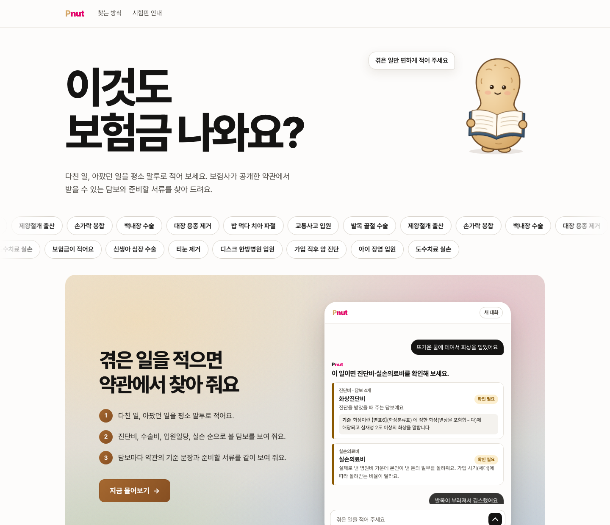
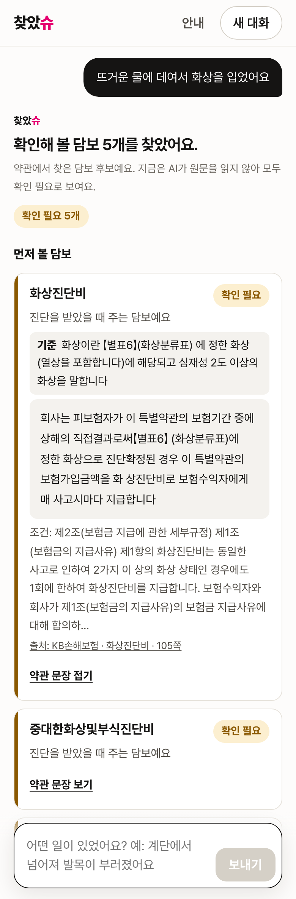
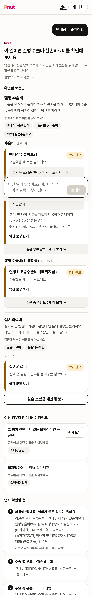
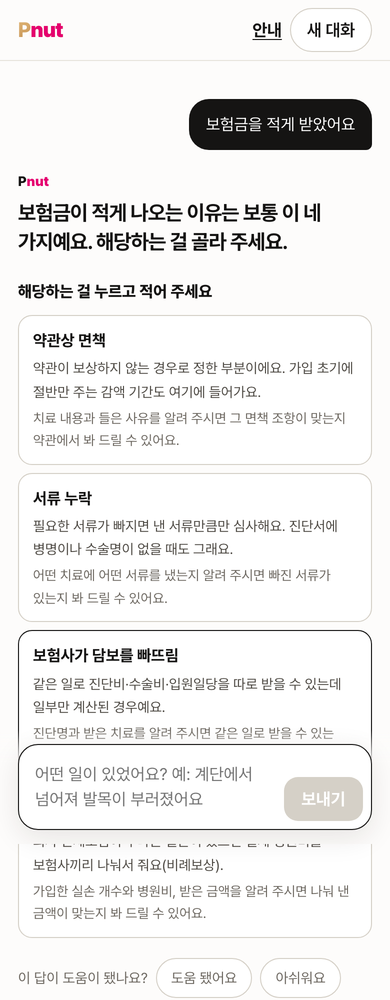
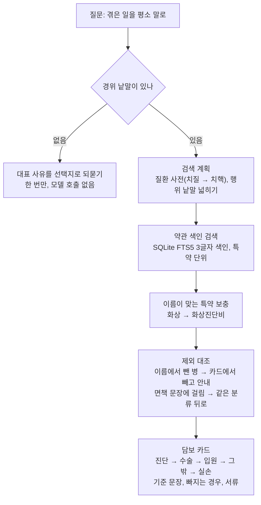
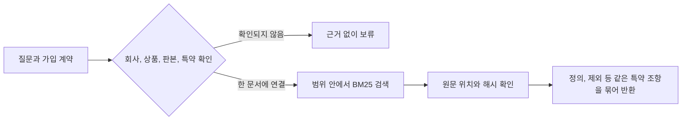

# 사고 경위로 보험 약관의 담보와 근거 조항을 찾는 찾았슈

[](https://github.com/wpalswpa/foundshu-rag-evidence/actions/workflows/verify.yml)

다친 일이나 아팠던 일을 평소 말로 적으면, 보험사가 공시한 약관 원문에서 확인할 담보를 찾아 진단비, 수술비, 입원일당, 실손 순으로 보여 준다. 담보마다 약관의 기준 문장, 빠지는 경우, 준비할 서류를 함께 붙인다. 보험금이 나오는지 정하지는 않는다. 약관을 펴기 전에 "어느 담보의 어느 조항을 읽어야 하는가"까지 좁혀 주는 것이 목적이다.

현재 상태는 다음과 같다.

- 된 것: 접근 코드로 제한한 공개 시연판이 클라우드에서 돈다. 공개판은 약관 색인 검색만 쓰고, 질문마다 언어 모델을 부르지 않는다.
- 안 된 것: 모델이 원문을 읽고 답하는 읽기 방식은 구현했지만 공개판에서 켜지 않았고 정확도를 재지 않았다. 색인된 약관은 14개다. 실제 사용자 검증과 보험사 연동은 없다.
- 이 저장소: 서비스 코드는 비공개다. 여기에는 작동 원리, 현재 화면, 측정 기록, 이전 실험(계약 범위 검색)의 공개 재현 코드를 둔다.

## 화면



<p>
  
  
  
</p>

| 질문 | 화면이 보여 주는 것 |
|---|---|
| 뜨거운 물에 데여서 화상을 입었어요 | 1번 화상진단비. '기준' 줄에 약관 정의(심재성 2도 이상의 화상)를 옮겨 둔다 |
| 백내장 수술했어요 | 이름에 '백내장 제외'가 붙은 수술비 담보 2개는 카드에서 빼고, 왜 뺐는지 안내 칸에 남긴다 |
| 보험금을 적게 받았어요 | 경위가 없어 담보를 늘어놓지 않고, 대표 사유 네 가지를 고르게 한다 |

## 작동 원리

공개판이 쓰는 검색 방식이다. 질문 하나에 모델 호출은 0회다.



1. **경위 확인**: 질문에서 일반어(보험금, 청구, 입원, 수술 등)와 처리 문제 낱말(적게, 거절 등)을 빼고 남는 낱말이 없으면 검색하지 않는다. 대신 사유를 선택지로 묻는다. 바로 앞 답이 되묻기였으면 다시 묻지 않는다.
2. **검색 계획**: 질환 사전으로 고객 말을 약관 말로 넓힌다(치질 → 치핵, 부러졌어요 → 골절).
3. **색인 검색**: 약관 PDF를 특약별 조각(지급, 면책, 한도, 정의 등 역할 표시)으로 나눠 SQLite FTS5 3글자 색인에 넣었다. 낱말 점수가 높은 특약을 찾는다.
4. **이름 보충**: 질문 낱말이 특약 이름에 들어 있으면(화상 → 화상진단비) 점수와 관계없이 후보에 넣는다.
5. **제외 대조**: 약관은 보장하는 병을 일일이 적지 않고 빼는 병만 이름에 적는다. 그래서 병 이름으로 검색하면 그 병을 뺀 특약이 먼저 걸린다. 이름의 '(…제외)' 괄호에 질문의 병이 있으면 카드에서 빼고 안내 칸에 남긴다. 면책 문장에 질문의 병이 걸린 담보는 같은 분류의 다른 담보 뒤로 보낸다.
6. **카드 구성**: 담보를 진단, 수술, 입원, 그 밖, 실손 순으로 놓는다. 지급 조항의 정의 문장을 '기준' 줄로 보이고, 수술이면 수술분류표에서 몇 종인지 읽는다.

**읽기 방식**은 구현했지만 공개판에서는 꺼 두었다. 위 검색에 더해 다음을 거친다.

1. 경위를 약관에서 쓰는 담보 이름과 의료 용어로 바꾼다.
2. 특약 목록 353개에서 읽을 특약을 고른다.
3. 고른 특약의 원문 조각과, 함께 봐야 하는 조항(정의, 면책, 감액, 분류표)을 모은다.
4. 해석이 갈리는 쟁점이면 분쟁 사례 카드에서 같은 쟁점을 찾는다. 없으면 법원 판례를 검색한다. 사례의 결론은 옮기지 않고, 결론이 갈린 조건만 쓴다.
5. 모델이 원문을 읽고 정해진 형식(JSON)으로 답한다.
6. 답의 인용문을 원문 조각과 대조한다. 글자와 숫자만 남겨 비교하고, 인용의 85% 이상이 원문에 이어서 있어야 통과한다. 통과하지 못한 인용은 버린다.

## 설계 판단

| 문제 | 선택 | 버린 대안과 이유 |
|---|---|---|
| 질문마다 비용이 든다 | 공개판은 색인 검색만 하고 모델을 부르지 않는다 | 질문마다 모델 호출은 비용과 응답 시간이 질문 수에 비례한다. 벡터 데이터베이스는 운영비가 들고, 이전 실험에서 모델 교체보다 검색 범위 제한의 효과가 컸다 |
| 검색만 한 답이 '안 나와요'를 잘못 단정했다 | 검색만 방식은 모든 담보를 '확인 필요'로 두고, 면책 문장은 확인할 점으로만 보인다 | 면책 문장에 질문 낱말이 있으면 제외로 판정하던 방식은 지급 질문 32개 중 10개를 '안 나와요'로 표시했다. 고객이 청구를 포기하게 만드는 오답이라 과장보다 위험하다 |
| 병 이름 검색이 그 병을 뺀 특약을 먼저 찾는다 | 특약 이름의 '(…제외)' 괄호를 읽는 일반 규칙 | 병마다 예외 목록을 두면 질병 수만큼 목록이 늘어난다 |
| 경위 없는 질문에 담보를 늘어놓았다 | 대표 사유 네 가지(약관상 면책, 서류 누락, 보험사의 담보 누락, 실손 비례보상)를 선택지로 한 번만 묻는다 | "무슨 일이 있었나요" 같은 열린 질문만 던지면 무엇을 적어야 할지 알기 어렵다 |
| 이름이 맞는 담보가 점수에서 밀렸다(화상 질문에서 화상수술비, 화상처치비가 앞서 화상진단비가 빠짐) | 질문 낱말이 이름에 든 특약을 후보에 넣고, 정의 문장을 '기준' 줄로 보인다 | 낱말 점수만으로 정하면 같은 낱말이 본문에 많이 나오는 특약이 앞선다 |
| 분쟁 사례 대부분이 부지급 결론이다 | 쟁점으로 대조하고, 사실관계가 다르면 결론 대신 갈리는 조건만 쓴다 | 사례 결론을 그대로 옮기면 답이 '안 나와요' 쪽으로 기운다 |
| 판단 목록이 코드에 흩어져 있었다 | 담보 순서, 일반어, 제외 표시, 되묻기 선택지를 데이터 파일로 분리하고 코드는 표만 적용한다 | 목록이 코드 안에 있으면 바꿀 때마다 코드를 고쳐야 한다 |

## 측정 결과

약관 특약 원문을 보고 모델이 만든 질문 62개로 검색만 방식을 쟀다(2026-11-11, 출처 특약이 모두 다르다). 질문과 정답 관계는 사람이 판정한 것이 아니다.

| 질문 종류 | 수 | 결과 |
|---|---:|---|
| 출처 담보가 지급되는 질문 | 32 | 출처 담보 또는 같은 이름 담보를 찾음 20, '안 나와요'로 잘못 표시 0, 못 찾음 12 |
| 출처 담보의 면책에 걸리는 질문 | 15 | 맞힘 0. 검색만 방식은 '안 나와요'를 단정하지 않으므로 이 종류는 맞힐 수 없다 |
| 비슷하지만 해당하지 않는 질문 | 15 | '받을 수 있어요' 과장 0 |

- 같은 질문의 첫 측정에서는 지급 질문 32개 중 10개를 '안 나와요'로 잘못 표시했다. 위 설계 판단의 두 번째 줄로 고쳤다.
- 못 찾은 12개에는 고객 말과 약관 말이 먼 질문("온몸 사진 찍는 검사" → 양전자단층촬영, "간질" → 뇌전증)과, 담보가 아니라 제도를 묻는 질문(보험료 자동납입)이 섞여 있다.
- 읽기 방식은 금감원 분쟁 사례 181개로 평가 자료를 답을 보기 전에 고정했지만, 아직 돌리지 않았다.
- 배포 전에 확인하는 행동: 이름에서 뺀 병의 특약이 카드에 없다(백내장, 대장 용종, 갑상선암, 치아). 관계없는 제외는 남는다(위암 질문의 '유사암 제외' 암진단비, 발목 골절 질문의 '치아파절 제외' 골절진단비). 경위가 없으면 모델을 부르지 않는다.

## 데이터 범위와 한계

- 약관 14개: 보험사 6곳(KB손해보험, 삼성화재, 한화생명, 현대해상, 라이나생명, 우체국보험)의 상품 약관 11개와 금융감독원 표준약관 3개다. 특약은 353개다(2026-11-11 기준).
- 분쟁 사례 카드 604건: 금감원 분쟁조정결정례 313, 분쟁조정사례 160, 법원 판례 91, 금감원 주요판례 20, 분쟁해결기준 19, 보도자료 1건에서 쟁점과 결과를 나눠 만들었다.
- 보험사가 6곳뿐인 이유: 여러 회사 약관을 한곳에 모은 협회 공시실은 자동 수집을 막는다. 생명보험협회 공시실은 robots.txt가 일반 수집기를 모두 금지하고, 손해보험협회 공시실은 자동 요청을 차단한다. 그래서 보험사 공식 사이트를 하나씩 찾아 받아야 하고, 사이트마다 구조가 달라 회사별 수집기가 필요하다. 다음 데이터 작업이 이것이다.
- 계약 정보 없이 묻는 질문이라 다른 회사의 약관을 예시로 보여 준다. 화면에도 "내 계약과 같은 상품이 아니라 다른 보험사 약관 예시"라고 적는다.
- 지급 여부 판정, 청구 대행, 보험사 연동은 하지 않는다.

## 이전 실험: 계약 범위 검색

처음에는 일반적인 RAG로 시작했다. 약관을 500자 조각(80자 겹침)으로 나누고, 한국어 임베딩 KURE-v1로 상위 10개를 찾아 생성 모델이 답하게 했다. 합성 사례 24건 중 근거가 필요한 18건에서 필요한 조항을 모두 찾은 것은 4건이었고, 24건 모두에 다른 계약이나 판본의 조항이 섞였다. 그래서 회사, 상품, 판본, 특약으로 검색 범위를 먼저 좁히는 방식을 만들었다.

| 검색 방식 | 범위 제한 없음 | 계약 범위 제한 |
|---|---:|---:|
| 낱말 검색(BM25) | 3/18 | 18/18 |
| 의미 검색(KURE-v1) | 4/18 | 17/18 |

수치는 필요 조항을 모두 찾은 사례 수다. 두 회사 약관의 지정 15쪽(79조각)을 썼고, 근거가 필요한 사례는 한 상품의 세 특약에 몰려 있다. 검색 조항 회수 결과이며 답변 정확도나 실제 지급 결과가 아니다. 사례 144행(24건 × 6방법)의 합계는 [기록](evidence/retrieval-record.json)에서 다시 계산한다. 자세한 구성과 해석은 [검색 비교 기록](evidence/README.md)에 있다.

이 저장소의 [retrieval.py](retrieval.py)는 그 검색 규칙을 표준 라이브러리만으로 다시 쓴 것이다.



## 직접 실행

Python 3.10 이상, 표준 라이브러리만 쓴다. API 키와 모델 다운로드가 필요 없다.

```bash
git clone https://github.com/wpalswpa/foundshu-rag-evidence.git
cd foundshu-rag-evidence
python retrieval.py
python -m unittest discover -s tests -v
python evidence/check_record.py
```

`retrieval.py`는 가상 문서에서 같은 질문의 상위 결과를 비교한다.

```text
unscoped evidence_for_review ['other-rider-event']
scoped evidence_for_review ['current-event']
bundle evidence_for_review ['current-event', 'current-exclusion']
```

범위가 없으면 이름이 비슷한 다른 특약을 먼저 찾는다. 범위를 제한하면 해당 특약을 찾고, 묶음에서는 순위 밖의 제외 조항도 함께 돌려준다. 설계 동작을 보이는 작은 예제이며 정확도 평가 자료가 아니다.

## 저장소 구성

| 위치 | 내용 |
|---|---|
| [retrieval.py](retrieval.py) | 계약 범위 확인, 인용 원문 검증, BM25 순위, 같은 특약 근거 묶음 |
| [examples/corpus.json](examples/corpus.json) | 직접 쓴 가상 문서, 특약, 질문. 실제 약관이 아니다 |
| [tests/](tests/) | 잘못된 범위, 불명확한 출처, 누락된 인용을 돌려주지 않는지 확인 |
| [evidence/](evidence/) | 이전 실험의 사례별 기록, 합계 재계산 검사, 화면 해시 기록 |
| [docs/design.md](docs/design.md) | 공개 재현의 범위와 검증 기준 |
| [docs/provenance.md](docs/provenance.md) | 비공개 서비스 코드와 공개 재현의 대응, 빠진 기능 |
| [docs/screenshots.md](docs/screenshots.md) | 화면을 찍은 조건 |

## 공개 범위

서비스 코드, 약관 PDF와 색인, 고객 자료, 계정과 키는 넣지 않았다. 화면은 공개 시연판과 같은 코드를 로컬에서 예시 질문으로 실행해 찍었고, 개인 정보는 없다. 화면 속 약관 문장은 보험사가 공시한 약관의 인용이다. 코드는 AI 코딩 도구와 함께 작성했고, 문제 정의와 평가 기준, 채택 판단은 설계 문서에 기록했다.
