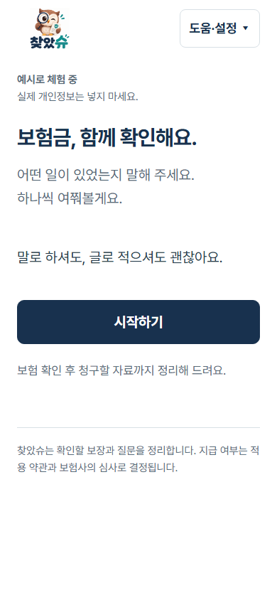
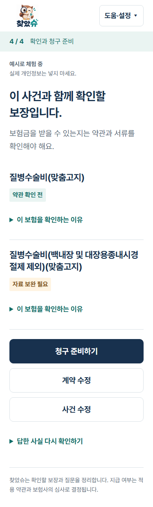
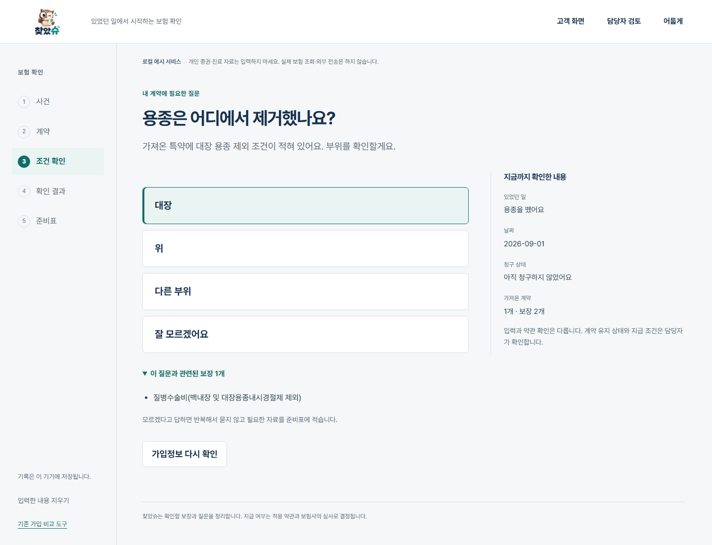
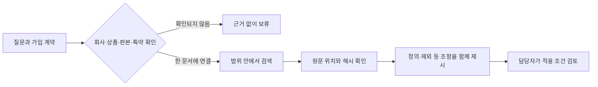

# 찾았슈의 계약 범위 검색과 RAG 비교

[](https://github.com/wpalswpa/foundshu-rag-evidence/actions/workflows/verify.yml)

찾았슈는 있었던 일과 가입 계약을 연결해 보험 청구 전에 확인할 질문·근거·서류를 정리하는 개인 프로젝트다. 이름이 비슷한 특약의 조항이 섞이는 문제를 **회사·상품·판본·특약으로 검색 범위를 제한**해 다뤘다.

이 저장소에는 핵심 검색 규칙의 공개 재현과 원본 화면을 담았다. 전체 서비스는 로컬 시제품이며 실제 고객 사용이나 보험사 접수를 연결하지 않았다. 생성형 RAG는 비교용 연구 경로이고, 보험금 지급 판단에 쓰지 않는다.

## 내 역할과 공개 이후

| 항목 | 내용 |
|---|---|
| 역할 | 개인 프로젝트다. 코드 · 합성 사례 · 비교 코드는 AI 코딩 도구와 함께 만들었다. |
| 처음 방식 | AWS 교육 과정 실습의 RAG 틀을 로컬로 옮긴 연구용 시험판: 약관을 500자 조각(80자 겹침)으로 나누고, 한국어 임베딩 KURE-v1(로컬 Ollama)로 코사인 유사도 상위 10개를 찾아 생성 모델이 답한다. |
| 처음 방식의 결과 | 같은 합성 24건에서 필요한 조항을 모두 찾은 사례가 18건 중 4건, 24건 모두에 다른 계약 · 판본 조항이 섞였다. 생성 답변은 계약 밖 질문 5건 모두에 결론과 조항을 붙였다(안전 검사만, 의미 정확도는 재지 않음). 그래서 생성은 판정 경로에서 빼고 비교용으로만 둔다. |
| 바꾼 방식 | 계약 범위를 먼저 좁히고 범위 안 BM25 → 원문 위치 · 해시 확인 → 같은 특약 근거 묶음(아래 결과: 18/18, 섞임 0). |
| 공개 이후(2026-10-12) | 인용 ID가 빠지거나 모호한 인용을 범위 거르기 전에 거절([fdb7a1e](https://github.com/wpalswpa/foundshu-rag-evidence/commit/fdb7a1e), [6f6d96c](https://github.com/wpalswpa/foundshu-rag-evidence/commit/6f6d96c)). |
| 다음 계획 | ① 실무자가 정답을 정한 사례로 평가를 늘린다 ② 동의어 · 풀어 쓴 질문에서 BM25와 임베딩의 순위 결합, 재순위 모델을 비교한다 ③ 생성 답변은 문장마다 인용 조항과 대조한 뒤에만 보여 준다. |


## 코드와 근거 읽는 순서

| 위치 | 역할 |
|---|---|
| [retrieval.py](retrieval.py) | 계약 범위 확인 → 인용 원문 검증 → BM25 순위 → 같은 특약의 근거 묶음 |
| [가상 말뭉치](examples/corpus.json) | 직접 작성한 문서·특약·질문. 실제 약관이 아님 |
| [행동 검사](tests/test_retrieval.py) | 잘못된 범위·불명확한 출처·누락된 인용을 반환하지 않는지 확인 |
| [기존 실험 집계 검사](evidence/check_record.py) | 저장된 기록의 합계와 화면 해시 확인. 검색·모델 재실행이 아님 |
| [구현 출처](docs/provenance.md) | 최신 로컬 제품 코드와 공개 재현의 대응 및 빠진 기능 |

고정 커밋 `47d27df`는 최초 공개 판본이다. 최신 기본 브랜치의 문서·오류 수정은 그 고정 링크에 소급되지 않는다. 아래 18건의 기존 실험 수치는 그대로 보존하며 새 회귀 검사를 검색 정확도로 합산하지 않는다.

## 서비스 화면

원본 시제품에서 예시 자료로 촬영한 화면이다. 공개 코드로 아래 서비스 전체를 실행할 수는 없다. [화면 출처와 범위](docs/screenshots.md)를 함께 확인할 수 있다.

<p>
  
  
</p>

같은 사건이라도 가져온 특약에 따라 확인할 사실이 달라진다.



## 해결한 문제

| 문제 | 선택 | 확인할 근거 |
|---|---|---|
| 유사한 문구를 가진 다른 특약이 검색됨 | 회사·상품·판본·특약 일치 후 검색 | [실행 코드](retrieval.py), 범위 제한 전후 예제 |
| 판본을 모를 때 최신 약관을 대신 적용할 수 있음 | 문서를 하나로 확정하지 못하면 보류 | 판본 누락·중복 문서·미등록 특약 검사 |
| 상위 몇 개만 읽으면 제외 조항이 빠질 수 있음 | 같은 특약의 주요 조항을 근거 묶음으로 반환 | 낮은 순위 제외 조항을 함께 반환하는 검사 |
| 검색 근거가 있어도 생성 답변이 틀릴 수 있음 | 검색 평가와 생성 평가를 분리 | [원본 비교 실험과 한계](evidence/README.md) |



## 직접 실행

Python 3.10 이상, 표준 라이브러리만 사용한다. API 키와 모델 다운로드가 필요 없다.

```bash
git clone https://github.com/wpalswpa/foundshu-rag-evidence.git
cd foundshu-rag-evidence
python retrieval.py
python -m unittest discover -s tests -v
python evidence/check_record.py
```

가상 문서에서 같은 질문의 상위 1개를 비교한다.

```text
unscoped evidence_for_review ['other-rider-event']
scoped evidence_for_review ['current-event']
bundle evidence_for_review ['current-event', 'current-exclusion']
```

첫 결과는 이름이 비슷한 다른 특약이다. 범위를 제한하면 해당 특약을 찾고, 묶음에서는 순위 밖 제외 조항도 함께 반환한다. 이는 설계 동작을 보여 주는 작은 예제이며 정확도 평가 자료가 아니다.

## 원본 비교 결과

개발자가 만든 합성 사례 24개 중 근거가 필요한 18개에서 **필요 조항을 모두 찾은 사례 수**를 비교했다. 다른 6개는 판본·상품 등이 맞지 않아 근거를 붙이면 안 되는 사례다.

| 검색 방식 | 범위 제한 없음 | 계약 범위 제한 |
|---|---:|---:|
| 낱말 검색 | 3/18 | 18/18 |
| 의미 검색(KURE-v1) | 4/18 | 17/18 |

두 회사 약관의 지정 15쪽에서 나온 79조각을 사용했으나, 양성 사례는 한 상품의 세 특약에 집중돼 있다. **검색 조항 회수 결과이며 답변 정확도나 실제 지급 결과가 아니다.** 작은 자체 평가에서는 모델 변경보다 검색 범위 제한의 차이가 컸다.

[144개 사례별 기록](evidence/retrieval-record.json)의 합계는 공개 검사로 다시 계산한다. 원문 약관과 임베딩은 포함하지 않아 원본 실험 전체를 이 저장소에서 재실행할 수는 없다. 공개 예제의 결과와 원본 실험 수치를 구분한다.

## 공개 범위와 읽는 순서

1. [설계와 대안](docs/design.md): 검색 흐름, 보류 조건, 공개 범위.
2. [구현의 출처와 차이](docs/provenance.md): 원본에서 가져온 규칙과 공개 재현에서 단순화한 부분.
3. [검사](tests/): 계약 범위, 원문 변조, 근거 묶음, 기록 합계.
4. [화면과 원본 실험](evidence/README.md): 확인한 것과 남은 조건.

약관 PDF·원문, 실제 계약과 고객 자료, 계정·키, 업무 데이터베이스, 사업계획·제출 서류는 포함하지 않았다. 코드는 AI 도구와 함께 작성했으며 문제 정의·평가 기준·채택 판단은 프로젝트 설계에 기록했다. 고객 계약의 진위와 적용 기간, 조항의 의미 적합성, 실제 업무 시간 절감은 이 공개 재현이 검증하지 않는다.
