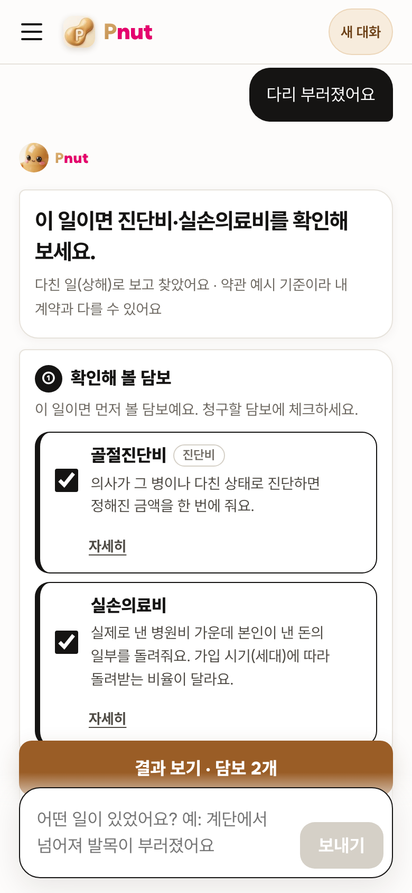
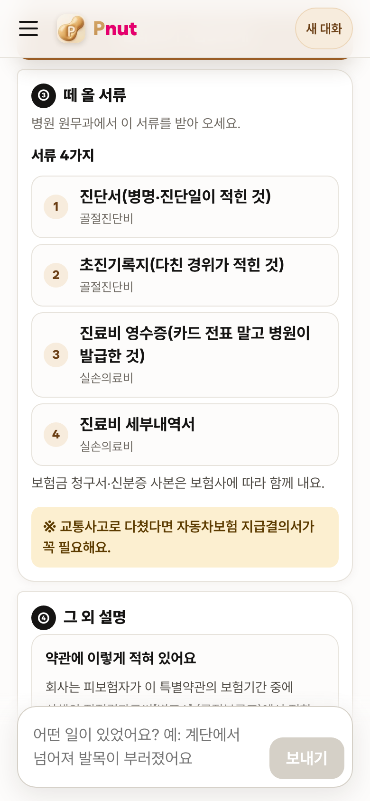
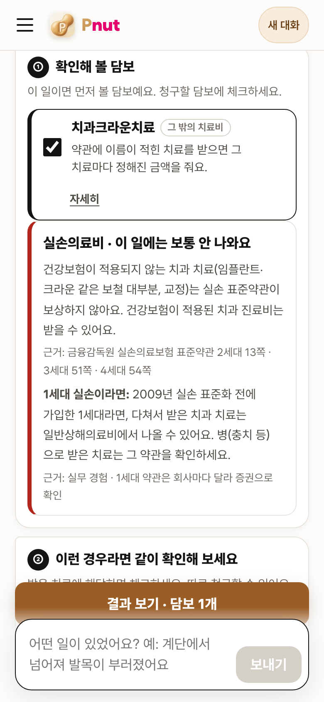
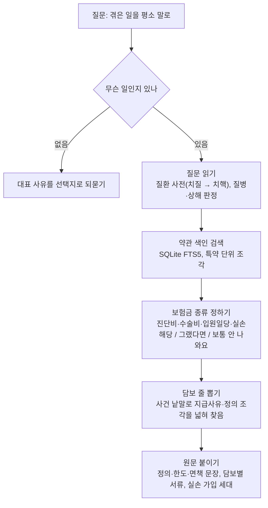

# 사고 경위로 보험 약관의 담보와 근거 조항을 찾는 피넛

[](https://github.com/wpalswpa/pnut-rag-evidence/actions/workflows/verify.yml)

다쳤거나 아팠던 일을 평소 말로 적으면 세 가지를 알려 준다.
- 확인해 볼 보험금 종류(진단비·수술비·입원일당·실손)
- 약관에서 찾은 담보 이름과 기준 문장
- 담보마다 떼 올 서류

보험금이 나오는지는 판정하지 않는다. 약관을 펴기 전에 "어느 담보의 어느 조항을 읽어야 하는가"까지 좁혀 주는 것이 목적이다. 공개 시연판은 접근 코드로 제한해 Google Cloud Run에서 돌고, 질문 하나에 언어 모델을 한 번도 부르지 않는다.

## 한눈에

| | |
|---|---|
| 문제 | 보험금을 청구하려면 가입한 담보, 그 담보의 약관 조항, 필요한 서류를 알아야 한다. 약관은 상품마다 수백 쪽이고 같은 보장도 회사마다 이름이 다르다 |
| 만든 것 | 보험사가 공시한 약관 71개를 특약 단위로 색인했다. 질문을 '질병·상해 → 보험금 종류 → 담보 → 원문 문장·서류' 순서로 답하는 웹 서비스다 |
| 핵심 판단 | 지급 여부는 단정하지 않는다. 사례를 외우지 않고, 약관에서 담보와 문장을 뽑는 일반 규칙을 데이터 표로 둔다. 모델은 사람이 정한 정답에서 이길 때만 들인다 |
| 확인한 결과 | 약관 원문으로 만든 지급 질문 32개 중 30개에서 해당 담보를 찾았고, '안 나와요'로 잘못 답한 것은 0개다. 평가에 쓰지 않은 일상 질문 80개에서 답의 담보 줄이 틀린 문항을 32개에서 1개로 줄였다(정답은 AI 판정이며 실무자 확인 전) |
| 역할 | 개인 프로젝트다. 문제 범위, 답의 형식, 평가 기준과 채택을 정했고, 코드는 AI 코딩 도구로 작성·검토했다([아래](#역할)) |

## 화면


<p>
  
  
  
  
</p>

| 질문 | 답이 보여 주는 것 |
|---|---|
| 다리 부러졌어요 | 첫 줄 "이 일이면 진단비·실손의료비를 확인해 보세요"와 함께 골절진단비·실손이 체크된 채 나온다. 깁스·부목·골절수술·철심 제거는 아래 '이런 경우라면'에 둔다. 청구할 담보를 고르고 결과 보기를 누르면 그 담보들의 서류를 겹치지 않게 모아 보인다 |
| 크라운 | 치과크라운치료 담보와, 실손이 보통 보상하지 않는 이유(건강보험이 적용되지 않는 치과 보철)를 표준약관 쪽수와 함께 보인다. 표준화 전에 가입한 1세대 실손은 다쳐서 받은 치과 치료를 보상할 수 있다는 줄을 출처와 함께 붙인다 |
| 보험금을 적게 받았어요 | 무슨 일인지 없어서 담보를 늘어놓지 않고 대표 사유를 선택지로 묻는다 |

화면을 찍은 조건과 판은 [화면 기록](docs/screenshots.md)에 있다.

## 어떻게 동작하나



1. **질문 읽기.** 일상어를 약관 말로 바꾸고(부러졌어요 → 골절) 질병인지 상해인지 정한다. 무슨 일인지 없는 질문("보험금을 적게 받았어요")은 검색하지 않고 사유를 묻는다.
2. **보험금 종류.** 가입 상황을 모르는 질문이라 담보 이름을 맞히는 대신 확인할 보험금 종류를 먼저 정한다. 질문에 근거가 있으면 '해당', 그 병에서 흔하면 '그랬다면'(수술했다면 → 수술비), 약관이 보상하지 않으면 '보통 안 나와요'와 표준약관 쪽수를 보인다.
3. **담보 줄.** 사건 낱말(골절)이 든 지급사유·정의 조각을 모든 약관에서 찾아 담보 이름별로 묶는다. 많은 상품에 있는 담보가 흔한 담보다. 질문과 부위가 다른 담보(갈비뼈 질문의 깁스·부목)는 약관의 대상 분류표로 거른다.
4. **원문 붙이기.** 담보마다 약관의 정의 문장, 한도·예외 문장, 서류 문장을 그대로 옮긴다. 약관에 없는 실무 지식(교통사고면 지급결의서, 1세대 실손의 예외)은 '실무 경험'으로 출처를 따로 단다.

판단 낱말(일반어, 질환 끝말, 면책 규칙, 부위 사전, 서류 규칙)은 데이터 표에 두고 코드는 표를 적용만 한다. 질문 문장별 분기는 두지 않는다.

## 설계 판단

| 문제 | 선택 | 버린 대안과 근거 |
|---|---|---|
| 검색만으로 '안 나와요'를 단정했다 | 면책은 '확인할 점'으로만 보이고, 표준약관이 분명히 빼는 경우만 '보통 안 나와요'로 둔다 | 면책 문장에 질문 낱말이 있으면 제외로 판정하던 방식은 지급 질문 32개 중 10개를 '안 나와요'로 표시했다. 청구를 포기하게 만드는 오답이라 과장보다 위험하다 |
| 질문마다 비용과 응답 시간이 든다 | 공개판은 색인 검색과 규칙만 쓰고 모델을 부르지 않는다 | 질문마다 모델을 부르면 비용이 질문 수에 비례하고, 답의 근거를 원문과 대조하기 어렵다 |
| 담보 이름을 맞히려다 엉뚱한 담보가 첫 줄에 왔다 | 질병·상해 → 보험금 종류를 먼저 정하고 그 안에 담보를 보인다 | 가입 상황을 모르는 질문에서 담보 이름을 맞히는 것은 목표가 될 수 없다. 종류는 수가 적어 규칙으로 정하고 빠짐·엉뚱함을 잴 수 있다 |
| 골절 질문에 깁스·부목 담보를 놓쳤다 | 예시 사례를 외우지 않고, 사건 낱말로 지급사유·정의 조각을 넓혀 찾는 일반 규칙 | 처음에는 골절 사례 목록을 만들었지만 예시 밖 사건에서 다시 틀려 버렸다 |
| 규칙을 고칠 때마다 같은 종류의 틀림이 다른 낱말로 나왔다('질환', '치료', '성대'가 든 담보) | 평가에 쓰지 않은 확인 질문 80개로 다섯 유형(상관없는 담보, 어색한 문장, 부위, 서류, 이어 묻기)을 세고, 유형마다 일반 규칙으로 고친 뒤 같은 80개로 다시 잰다 | 눈에 띈 질문만 고치면 고친 문항 수만 늘고 같은 유형이 남는다 |
| 실손은 가입 시기마다 보상이 다르다 | 실손 규칙에 가입 세대 문장을 두고, 표준약관 원문과 실무 경험을 출처로 나눠 보인다 | 표준약관 하나로만 말하면 1세대 실손 가입자에게 틀린 답이 된다 |
| 배포한 판이 클라우드 메모리 1GiB를 넘겨 질문마다 오류가 났다 | 새 판을 트래픽 없이 올려 막힘·입장·질문 시험을 통과할 때만 트래픽을 넘긴다 | 로컬 시험은 클라우드 메모리 문제를 잡지 못했다. 고장 난 판으로 이 시험이 오류를 잡는 것을 확인했다 |
| 재정렬 모델이 AI가 만든 시험에서 크게 좋아졌다 | 사람이 고정한 평가에서 나아지지 않아 채택하지 않았다 | AI가 만든 질문·정답 208개에서는 상위 3 적중 74.0% → 97.1%였지만, 사람이 고정한 20건에서는 18 → 17이었다 |

## 확인한 결과

| 무엇을 | 조건 | 결과 |
|---|---|---|
| 지급 질문에서 해당 담보 찾기 | 약관 특약 원문을 보고 AI가 만든 질문 62개(출처 특약이 모두 다름), 2026-11-12 | 지급 질문 32개 중 찾음 30, '안 나와요' 오답 0. 비슷하지만 해당 안 되는 질문 15개에서 '받을 수 있어요' 과장 0 |
| 같은 질문의 변화 | 위와 같은 62개 | 찾음 10 → 30, '안 나와요' 오답 10 → 0(첫 측정은 약관 14개) |
| 답의 담보 줄 | 평가에 쓰지 않은 일상 질문 80개, 다섯 유형으로 판정 | 하나라도 틀린 문항 32 → 1. 정답은 AI가 판정했고 실무자 확인 전이다 |
| 보험금 종류와 질병·상해 판정 | 규칙을 다듬는 데 쓴 개발 29문항, 손대지 않은 시험 30문항 | 개발: 빠진 종류 0/46, 엉뚱한 종류 0. 시험: 빠진 종류 1/56, 엉뚱한 종류 0, 질병·상해 틀림 3 |
| 공개판 보안 | 막힘·소개·대화·결과 보기·실손 계산을 실제 브라우저로 누름 | 콘텐츠 보안 정책(CSP) 위반 0, 스크립트 오류 0 |

못 찾은 지급 질문 2개는 담보가 아니라 계약 조건(특별조건부 인수, 이륜자동차 부담보)을 묻는 질문이다. 계약 조건은 담보 카드가 아니라 조건 문장으로 답해야 해서 따로 다룬다.

## 다음 단계: 질문 이해와 재정렬 모델

규칙으로 고친 만큼은 줄었지만, 사전 밖 일상어와 낱말 조각이 겹치는 담보는 규칙만으로 끝이 나지 않는다. 그래서 질문 읽기와 후보 고르기에 모델을 들인다. 순서는 다음과 같다.
1. 실무자가 확정한 정답 세트를 만든다.
2. 지금 방식의 기준선을 잰다.
3. 재정렬과 질문 읽기 모델을 그 정답으로 비교한다.
4. 기준선을 넘은 것만 별도 서비스로 띄운다.

자세한 단계와 통과 기준은 [모델 수립 계획](docs/model-plan.md)에 있다.

## 역할

개인 프로젝트다.

- **직접 정한 것.**
  - 문제 범위(지급 판정은 하지 않고 확인할 담보와 조항까지)와 답의 형식(보험금 종류 먼저, 담보를 고르면 서류).
  - 공개판에서 외부 AI를 쓰지 않는 결정.
  - 평가 기준과 채택 여부.
  - 실무 지식: 실손 기본 서류는 영수증과 세부내역서, 교통사고는 지급결의서, 1세대 실손의 예외.
- **AI 코딩 도구에 맡긴 것.** 코드 작성, 약관 수집과 색인, 평가 스크립트, 판정 초안.
- **검토한 방식.** 공개판을 직접 써 보며 틀린 답을 찾았다. 찾은 틀림을 사례로 외우지 않고 일반 규칙으로 고치게 했고, 같은 평가로 다시 재서 받아들였다.

## 이 저장소에서 확인할 수 있는 것

서비스 코드는 비공개다. 여기에는 작동 원리, 화면, 측정 기록, 그리고 처음 실험(계약 범위 검색)의 공개 재현 코드를 둔다.

| 위치 | 내용 |
|---|---|
| [docs/model-plan.md](docs/model-plan.md) | 질문 이해·재정렬 모델 수립 계획과 통과 기준 |
| [docs/screenshots.md](docs/screenshots.md) | 화면을 찍은 조건과 판 |
| [retrieval.py](retrieval.py) | 계약 범위 확인, 인용 원문 검증, BM25 순위, 같은 특약 근거 묶음(표준 라이브러리만) |
| [tests/](tests/) | 잘못된 범위, 불명확한 출처, 누락된 인용을 돌려주지 않는지 확인 |
| [evidence/](evidence/) | 처음 실험의 사례별 기록, 합계 재계산 검사, 화면 해시 기록 |
| [docs/design.md](docs/design.md), [docs/provenance.md](docs/provenance.md) | 공개 재현의 범위와 비공개 서비스 코드와의 대응 |

```bash
git clone https://github.com/wpalswpa/pnut-rag-evidence.git
cd pnut-rag-evidence
python retrieval.py
python -m unittest discover -s tests -v
python evidence/check_record.py
```

Python 3.10 이상, 표준 라이브러리만 쓴다. API 키와 모델 다운로드가 필요 없다.

## 처음 실험: 계약 범위 검색

처음에는 일반적인 RAG로 시작했다. 약관을 500자 조각으로 나누고 한국어 임베딩(KURE-v1)으로 상위 10개를 찾아 생성 모델이 답하게 했다. 합성 사례 24건 중 근거가 필요한 18건에서 필요한 조항을 모두 찾은 것은 4건이었고, 24건 모두에 다른 계약이나 판본의 조항이 섞였다. 그래서 회사, 상품, 판본, 특약으로 검색 범위를 먼저 좁혔다.

| 검색 방식 | 범위 제한 없음 | 계약 범위 제한 |
|---|---:|---:|
| 낱말 검색(BM25) | 3/18 | 18/18 |
| 의미 검색(KURE-v1) | 4/18 | 17/18 |

필요 조항을 모두 찾은 사례 수다. 두 회사 약관의 지정 15쪽(79조각)으로 쟀고, 검색 조항 회수 결과이며 답변 정확도가 아니다. 사례별 기록과 합계 재계산은 [evidence/](evidence/README.md)에 있다.

## 데이터 범위와 공개 범위

- 약관 71개: 보험사 7곳의 상품 약관 68개(NH농협손해보험 38, KB손해보험 20, 현대해상 3, 우체국보험 3, 라이나생명 2, 삼성화재 1, 한화생명 1)와 금융감독원 실손 표준약관 3개.
- 분쟁 사례 749건: 금감원 분쟁조정결정례·사례, 법원 판례, 주요판례, 분쟁해결기준, 보도자료.
- 약관 수집은 회사 공시실에서 robots.txt를 확인한 경로만, 요청 간격을 두고 받는다. 여러 회사를 모은 협회 공시실은 자동 수집을 막아 쓰지 않는다.
- 질문한 사람의 계약을 모르므로 화면의 담보는 다른 보험사 약관의 예시다. 화면에도 그렇게 적는다.
- 이 저장소에는 서비스 코드, 약관 PDF와 색인, 고객 자료, 계정과 키를 넣지 않았다. 화면은 공개 시연판을 예시 질문으로 찍었고 개인 정보는 없다. 화면 속 약관 문장은 보험사 공시 약관의 인용이다.
