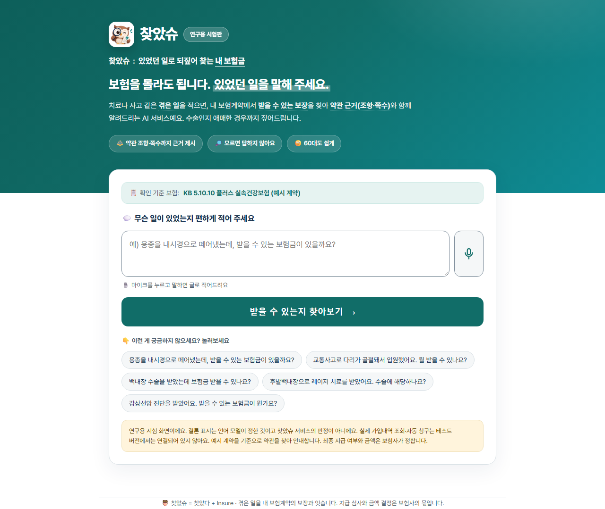

# 원본 시제품 화면

예시 입력으로 실행한 로컬 화면을 그대로 옮겼다. 실제 고객 자료가 아니며, 이미지를 합성하거나 결과 문구를 바꾸지 않았다. 화면별 SHA-256은 [기록](../evidence/screenshots.json)에 있다. 서로 다른 화면 경로의 캡처이며 하나의 연속 사용 기록을 뜻하지 않는다.

| 화면 | 보여 주는 것 | 범위 |
|---|---|---|
| [고객 시작](images/customer-start.png) | 예시 체험 표시, 사건 입력 시작 | 모바일 고객 화면 |
| [보장 확인](images/customer-review.png) | 보장별 약관 확인 전·자료 보완 상태 | 지급 확정 결과가 아님 |
| [조건 질문](images/contract-question.png) | 가져온 특약에 따른 용종 제거 부위 질문 | 예시 사건, 실제 접수 없음 |
| [연구 채팅](images/research-chat.png) | 약관 검색과 생성 답변을 잇는 시험판 입력 | 기본 판정 경로와 분리 |

## 생성형 연구 화면

이 화면의 문구와 버튼은 시험 당시 상태다. '받을 수 있는지 찾아보기'의 답변을 서비스의 검증된 지급 판정으로 읽으면 안 된다. 원본 시험에서 검색한 제외 조항과 모순되는 생성 답변이 관찰됐다. 이 저장소에는 그 답을 성공 사례로 싣지 않으며, 생성 모델을 지급 판단에 사용하지 않는다.
